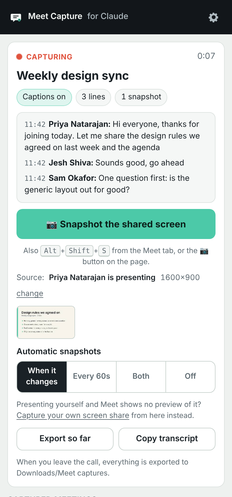
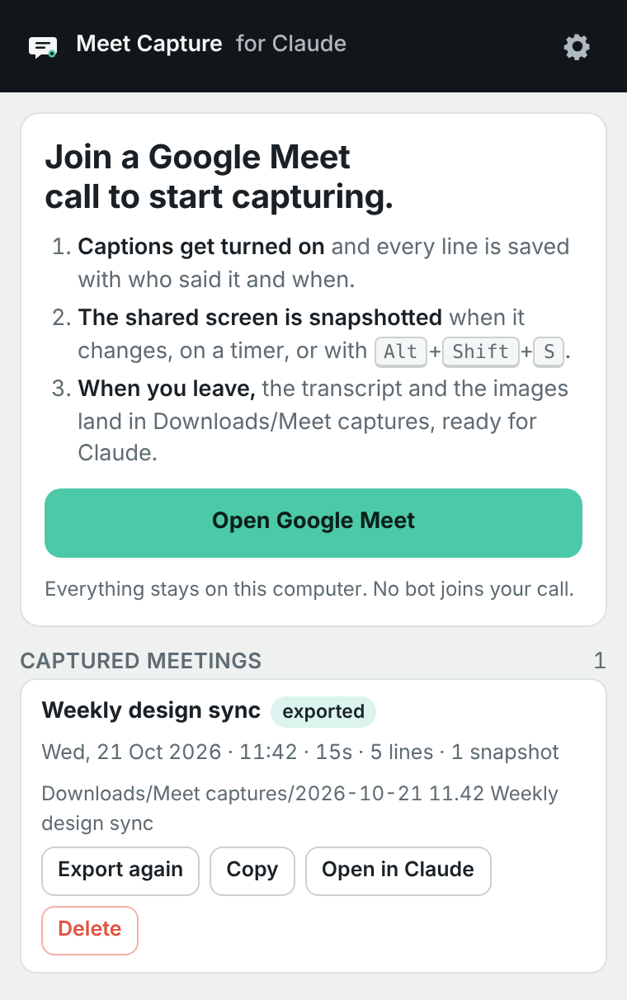

# Meet Capture for Claude

Keep Claude in the loop on your Google Meet calls. While you're in a call, this Chrome extension saves the live captions with speaker names and timestamps, takes snapshots of the shared screen, and when you leave it writes one Claude-ready folder into your Downloads. No bot joins the call, no account is needed, and nothing leaves your browser.

It replaces the wait for Gemini's notes: no email that arrives a day later, no summary that never comes. The transcript is on your disk the moment you hang up, ready to drop into Claude.

This tool is unofficial. It is not made by or affiliated with Google or Anthropic.

<p>
  
  
</p>

[What you get](#what-you-get) · [Install](#install) · [Privacy](#privacy-and-security) · [Privacy policy](PRIVACY.md)

## Use

1. Join a Google Meet call. The extension switches captions on (the CC button) if they're off, because the transcript is built from them. A small **Capturing** pill appears at the bottom of the call.
2. Click the extension's icon in Chrome's toolbar to open the side panel. If you can't see the icon, pin it from the puzzle-piece menu. The panel shows the captions as they come in, how many lines and snapshots you have, and which video it snapshots.
3. When someone shares a screen, snapshots are taken on their own each time the shared screen changes. Press **Alt+Shift+S**, the **📷 Snapshot** button on the pill, or the big button in the panel for one right now.
4. Leave the call. Everything is exported to `Downloads/Meet captures/` and the panel shows where. Open [claude.ai](https://claude.ai), drag the folder's files into the chat, and ask away. Or click **Open in Claude** in the panel, which opens a new Claude chat with the transcript already in the message box.

Tell the people in the call that you're saving the captions, the same way you would say that you're recording.

## What you get

```
Downloads/Meet captures/2026-10-21 14.30 Weekly design sync/
  transcript.md      the whole call, written for Claude
  snapshot-01.png    the shared screen, each time it changed
  snapshot-02.png
  meeting.json       the same data as JSON (optional, off by default)
```

**The transcript** starts with the title, the date and times, how long the call was, who spoke, and a note you can set once that goes at the top of every transcript (for example "Summarise the decisions and list action items with owners"). Then the captions, one line per turn:

```
> 📷 Snapshot 1 · 14:32:10 · snapshot-01.png

**[14:32:14] Priya Natarajan:** Let me share the design rules we agreed on last week.

**[14:32:31] Jesh Shiva:** Sounds good, go ahead.
```

Snapshots are listed at the top and marked in the transcript where they were taken, so Claude knows which image goes with which words. Your own lines, which Meet labels "You", get your name. Meet's captions are automatic speech recognition, so names and words can be wrong; the transcript says so.

**Snapshots** are taken from the video Meet is showing you. The extension picks the presentation when Meet marks one, otherwise the widest video on the page. You can pick a different one in the panel. Three modes: when the shared screen changes (the default), on a timer, or both; or off, for manual snapshots only. If you're the one presenting and Meet shows you no preview of your own share, the panel can capture your screen share directly.

You can also export mid-call (**Export so far**), copy the transcript to paste anywhere, or get everything as one ZIP instead of a folder. Captured meetings stay in the panel for 30 days (you can change that), so you can export or copy a past call again.

## Install

**From the Chrome Web Store:** coming soon.

**Or load it from GitHub:** download the [latest release](https://github.com/jeshwanthshivasai/meet-capture-for-claude/releases/latest), unzip it, and keep that folder. Then open `chrome://extensions`, turn on **Developer mode**, click **Load unpacked**, and pick the folder that contains `manifest.json`. You'll need Chrome 116 or later. Other Chromium browsers with a side panel should work but haven't been tested.

## How it works

There is no server and no account. The extension runs only on `meet.google.com` pages.

- **Captions.** A script in the Meet tab watches the captions region that Meet draws when captions are on. Meet shows a rolling window of each speaker's last words and rewrites it as the speech recognition corrects itself. The script stitches those windows into full lines, keeps the first time each line appeared, and notices when a block is re-rendered so nothing is saved twice.
- **Snapshots.** The same script looks at the `<video>` elements on the page, finds the shared screen, and compares a tiny greyscale version of each frame with the last saved one. When enough of it changes and the picture has settled, it draws the frame to a canvas and saves it as a PNG.
- **Storage.** Lines and snapshots go to the extension's own IndexedDB as they arrive, so a crashed tab or a closed laptop loses at most a few seconds.
- **Export.** When you leave the call, the extension writes the Markdown and the images and hands them to Chrome's downloads, into a folder named after the meeting.

| File | What it does |
|---|---|
| `src/captions.js` | finds the captions region, reads speaker and text, stitches the rolling windows into lines |
| `src/snapshot.js` | finds the shared screen among the videos, detects changes, captures frames |
| `src/content.js` | runs in the Meet tab: joins and leaves, switches captions on, the pill, sends everything to the worker |
| `src/store.js` | IndexedDB: meetings, lines, snapshots |
| `src/export.js` | the transcript (Markdown) and the JSON |
| `src/zip.js` | the ZIP file, written from scratch so there's no third-party code to trust |
| `background.js` | the service worker: storage, export, downloads, the keyboard shortcut |
| `offscreen/` | a hidden page that builds the files for download (service workers can't make blob URLs) |
| `sidepanel/` | the side panel |

`node test/run.js` runs the unit tests (no network, no browser). `node test/e2e.js` runs the real extension in Chromium against a fake Meet page with a scripted call, and checks the captions, the snapshots and the exported files.

## Privacy and security

- **Runs entirely in your browser.** It reads what Meet already shows on your screen: the captions and the video. It doesn't record audio, doesn't join the call as a participant, and doesn't use any Google or Anthropic API.
- **Sends nothing anywhere.** There are no servers, analytics, third-party code, remote scripts or remote fonts. The one exception is the **Open in Claude** button: it opens `claude.ai/new` with the transcript in the page address so it lands in the message box. That happens only when you click it, and only then does the transcript reach Anthropic, the same as pasting it. Transcripts over 60,000 characters are copied instead, for you to paste.
- **Stores on this computer only.** Captions and snapshots are kept in the extension's storage for 30 days (0 keeps them until you delete them). Exported files are ordinary files in your Downloads. Settings are kept in Chrome's extension storage.
- **Permissions:**
  - a script on `meet.google.com`: reads the captions and video there, and clicks the captions button. Chrome calls this "read and change your data on meet.google.com".
  - `downloads`: saves the exported files. Chrome calls this "manage your downloads". The extension only creates files in `Downloads/Meet captures`; it never reads or deletes downloads.
  - `storage` and `unlimitedStorage`: keep captured meetings and your settings, without Chrome's small default quota getting in the way of snapshots.
  - `sidePanel` and `offscreen`: the panel, and the hidden page that builds the files. Neither shows an install warning.
- **Your transcript can contain anything that was said**, including other people's words and whatever was on a shared screen. Keep the folder somewhere private, and tell the people in the call. Depending on where you and they are, saving what is said in a meeting can need their consent.
- **It depends on Meet's page layout**, which Google changes without notice. It finds the captions by their accessibility label first and by their structure second, so small changes shouldn't matter; a big one would stop the transcript until an update.

## If something went wrong

- **The pill says "waiting for captions":** Meet hasn't shown the captions region yet. Click the CC button in Meet yourself. If captions are on and the pill still waits, Meet's layout may have changed; open an issue with your Chrome version and the date.
- **The transcript is empty:** captions were off for the call. The transcript says so. Meet's captions are per-person, so they must be on in your own Meet window.
- **Snapshots show the wrong video:** click **change** next to the source in the panel and pick the presentation.
- **No snapshots of your own share:** Meet often shows no preview of your own screen share. Use **Capture your own screen share** in the panel and pick the window or screen you're sharing. Keep the panel open while it runs.
- **Nothing was exported when I left:** open the panel; the meeting is in **Captured meetings** with an **Export** button. If Chrome asked whether Meet can download multiple files, choose **Allow**; it only asks once.
- **The files have odd names like `transcript (1).md`:** a folder with the same name already existed, so Chrome kept both.
- **"Storage is not available":** Chrome's storage for this extension is blocked or full. Check `chrome://settings/content/siteData`, or clear old meetings in the panel's settings.

## License

MIT
