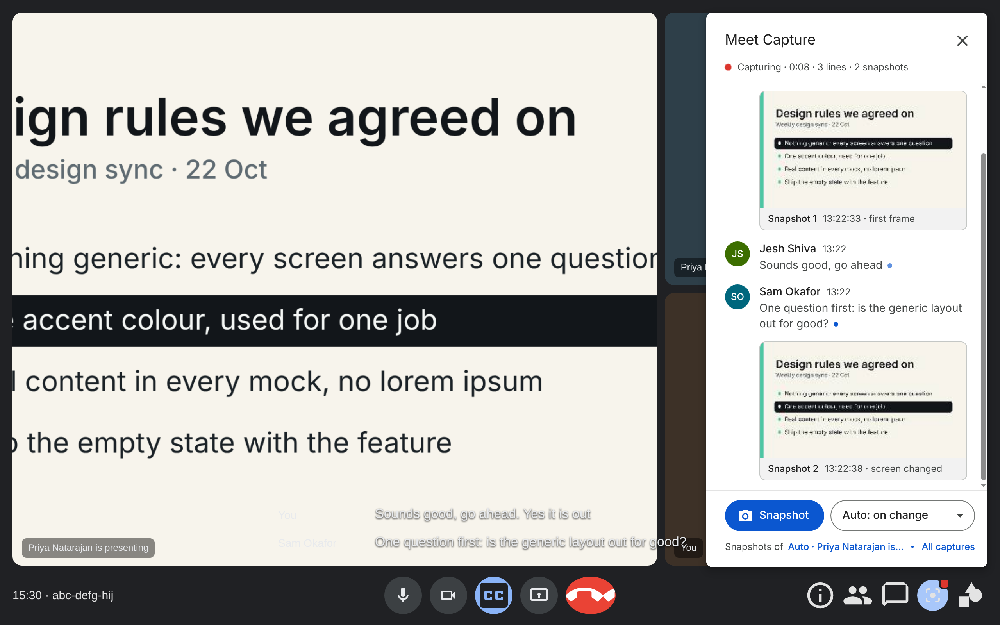
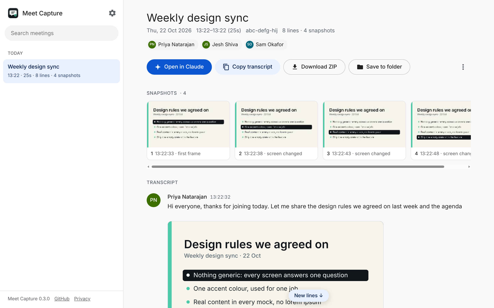

# Meet Capture for Claude

Keep Claude in the loop on your Google Meet calls. A capture button sits in Meet's own bar. While you're in a call, the live captions become a transcript with names and times, and the shared screen is snapshotted each time it changes. The moment you leave, the meeting opens on your captures page, ready to hand to Claude: open it in Claude, copy it, save one ZIP, or write everything into a folder of your choice. No bot joins the call, no account is needed, and nothing leaves your browser.

It replaces the wait for Gemini's notes: no email that arrives a day later, no summary that never comes.

This tool is unofficial. It is not made by or affiliated with Google or Anthropic.

<p>
  
</p>
<p>
  
</p>

[What you get](#what-you-get) · [Install](#install) · [Privacy](#privacy-and-security) · [Privacy policy](PRIVACY.md) · [Changelog](CHANGELOG.md)

## Use

1. **Join a Google Meet call.** The capture button joins Meet's bottom bar, next to Chat, and its panel opens on the right like Meet's People and Chat panels. Captions are switched on (the CC button) if they're off, because the transcript is built from them.
2. **Talk, share, present.** Every caption lands in the panel as a line with the speaker's name and the time. When someone shares a screen, a snapshot is taken the moment it changes and once more when it has settled; snapshot cards appear in the feed between the lines. Press **Snapshot** in the panel or **Alt+Shift+S** (from any app) for one right now. If you're the one presenting, click **Capture my share** in the panel: Chrome asks once which window or screen to watch, and from then on your share is snapshotted as it changes, whatever you switch to. Meet's own preview of your share stops updating once its tab is in the background, which is why this step exists.
3. **Leave.** Your captures page opens on the meeting, and a small card on Meet's "You left" page offers the same. On the page: the transcript with the snapshots in place, **Open in Claude** (a new claude.ai chat with the transcript already in the message box), **Copy transcript**, **Download ZIP** (one file in Downloads/Meet captures), and **Save to folder** (pick a folder once; after that every meeting can be written there without a question).

Tell the people in the call that you're saving the captions, the same way you would say that you're recording.

## What you get

Your captures page keeps every meeting for 30 days (change it in the settings). Each meeting has its transcript, its snapshots, a lightbox with **Copy image** for pasting a snapshot into a chat, and a rename. A ZIP or a folder save gives you:

```
2026-10-22 14.30 Weekly design sync/
  transcript.md      the whole call, written for Claude
  snapshot-01.png    the shared screen, each time it changed
  snapshot-02.png
  meeting.json       the same data as JSON (optional, off by default)
```

**The transcript** starts with the title, the date and times, how long the call was, who spoke, and a note you can set once that goes at the top of every transcript (for example "Summarise the decisions and list action items with owners"). Then the captions, one line per turn:

```
> 📷 Snapshot 1 · 14:32:10 · snapshot-01.png

**[14:32:14] Priya Natarajan:** Let me share the design rules we agreed on last week.

**[14:32:31] Jesh Shiva:** Sounds good, go ahead.
```

Snapshots are listed at the top and marked in the transcript where they were taken, so Claude knows which image goes with which words. Meet keeps one caption block for as long as one person talks, so a line is cut at pauses of a few seconds and, in long runs, at sentence ends; each line keeps the time its words started. Your own lines, which Meet labels "You", get your name, read from your Google account or from the setting. Meet's captions are automatic speech recognition, so names and words can be wrong; the transcript says so.

**Snapshots** come from the video Meet is showing you: the presentation when Meet marks one, otherwise the widest video on the page, or the one you pick in the panel. A new picture is kept the moment it appears, so a tab you flick past is still there, and again when it has settled if it ended up different; a picture seen a moment ago is not kept twice, and a video or constant scrolling is rationed to one every so often. Three modes: when the shared screen changes (the default), on a timer, or both; or off, for manual snapshots only.

## Install

**From the Chrome Web Store:** coming soon.

**Or load it from GitHub:** download the [latest release](https://github.com/jeshwanthshivasai/meet-capture-for-claude/releases/latest), unzip it, and keep that folder. Then open `chrome://extensions`, turn on **Developer mode**, click **Load unpacked**, and pick the folder that contains `manifest.json`. You'll need Chrome 116 or later. Other Chromium browsers should work but haven't been tested.

## How it works

There is no server and no account. The extension runs only on `meet.google.com` pages and on its own captures page.

- **Captions.** A script in the Meet tab watches the captions region that Meet draws when captions are on. Meet shows a rolling window of each speaker's last words and rewrites it as the speech recognition corrects itself. The script stitches those windows into full lines, keeps the first time each line appeared, and notices when a block is re-rendered so nothing is saved twice.
- **Snapshots.** The same script looks at the `<video>` elements on the page, finds the shared screen, and compares a tiny greyscale version of each frame with the last saved one, about once a second. A changed picture is captured at first sight and again once it holds still; recent pictures are remembered so the same slide is not kept twice. For your own share, frames are read straight from the capture track (`ImageCapture.grabFrame`), so they stay current while the Meet tab is in the background.
- **The UI in Meet.** The bar button and the panel live in shadow roots, so Meet's styles don't reach them and theirs don't reach Meet. The button copies the size and shape of Meet's own buttons; the panel steps aside when you open Meet's chat or people list, as Meet's own panels do.
- **Storage.** Lines and snapshots go to the extension's own IndexedDB as they arrive, so a crashed tab or a closed laptop loses at most a few seconds.
- **After the call.** The service worker opens the captures page on the meeting (or saves a ZIP, or both, or nothing: your choice). The page reads the meeting from IndexedDB; **Save to folder** writes files with the File System Access API into the folder you picked, which needs no extra permission and no download prompts.

| File | What it does |
|---|---|
| `src/captions.js` | finds the captions region, reads speaker and text, stitches the rolling windows into lines |
| `src/snapshot.js` | finds the shared screen among the videos, decides when the picture changed, captures frames |
| `src/ui.js` | the button in Meet's bar, the docked panel, the card after the call |
| `src/content.js` | runs in the Meet tab: joins and leaves, switches captions on, drives the UI, sends everything to the worker |
| `src/store.js` | IndexedDB: meetings, lines, snapshots, the chosen folder |
| `src/export.js` | the transcript (Markdown), the JSON, the ZIP |
| `src/zip.js` | the ZIP writer, written from scratch so there's no third-party code to trust |
| `background.js` | the service worker: storage, what happens after a call, the ZIP download, the keyboard shortcut |
| `offscreen/` | a hidden page that builds the ZIP for download (service workers can't make blob URLs) |
| `app/` | the captures page |

`node test/run.js` runs the unit tests (no network, no browser). `node test/e2e.js` runs the real extension in Chromium against a fake Meet page with a scripted call, and checks the button in the bar, the panel, the captions, the snapshots, the page that opens on leaving, Open in Claude, the ZIP, the folder save, a rename and a reload mid-call.

## Privacy and security

- **Runs entirely in your browser.** It reads what Meet already shows on your screen: the captions and the video. It doesn't record audio, doesn't join the call as a participant, and doesn't use any Google or Anthropic API.
- **Sends nothing anywhere.** There are no servers, analytics, third-party code, remote scripts or remote fonts. The one exception is **Open in Claude**: it opens `claude.ai/new` with the transcript in the page address so it lands in the message box. That happens only when you click it, and only then does the transcript reach Anthropic, the same as pasting it. Transcripts over 60,000 characters are copied instead, for you to paste.
- **Stores on this computer only.** Captions and snapshots are kept in the extension's storage for 30 days (0 keeps them until you delete them). ZIPs and folder saves are ordinary files on your disk. Settings are kept in Chrome's extension storage.
- **Permissions:**
  - a script on `meet.google.com`: reads the captions and video there, clicks the captions button, and adds the capture button and panel to the page. Chrome calls this "read and change your data on meet.google.com".
  - `downloads`: saves the ZIP. Chrome calls this "manage your downloads". The extension only creates files in `Downloads/Meet captures`; it never reads or deletes downloads.
  - `storage` and `unlimitedStorage`: keep captured meetings and your settings, without Chrome's small default quota getting in the way of snapshots.
  - `offscreen`: the hidden page that builds the ZIP. It shows no install warning.
  - **Save to folder** uses Chrome's own folder picker. Chrome keeps the choice and may ask for one click to confirm it the next time the page writes there.
- **Your transcript can contain anything that was said**, including other people's words and whatever was on a shared screen. Keep the files somewhere private, and tell the people in the call. Depending on where you and they are, saving what is said in a meeting can need their consent.
- **It depends on Meet's page layout**, which Google changes without notice. It finds the captions by their accessibility label first and by their structure second, and the bar by the labels of Meet's own buttons, so small changes shouldn't matter; a big one would stop the transcript until an update.

## If something went wrong

- **The panel says "waiting for captions":** Meet hasn't shown the captions region yet. Click the CC button in Meet yourself. If captions are on and the panel still waits, Meet's layout may have changed; open an issue with your Chrome version and the date.
- **No capture button in the bar:** the panel still works from the toolbar icon's page; the button is placed next to Meet's Chat button and needs Meet's bar to be there. If Meet's bar is hidden (full-screen, or a very narrow window), move the mouse or widen the window.
- **The transcript is empty:** captions were off for the call. The transcript says so. Meet's captions are per-person, so they must be on in your own Meet window.
- **Snapshots show the wrong video:** pick the presentation in the panel's **Snapshots of** menu.
- **Snapshots of my own share only show the Meet window:** Meet's preview of your share stops updating once the Meet tab is in the background. Click **Capture my share** in the panel and pick the screen or window you're sharing; snapshots then follow whatever is on it. Someone else's share is a video Meet streams to you, and Meet pauses it for a hidden tab, so keep the Meet tab visible while they present.
- **The captures page did not open when I left:** click the toolbar icon; the meeting is in the list. Check **When you leave a call** in the settings.
- **"Chrome did not allow writing to the folder":** Chrome needs a click on **Save to folder** to confirm the folder again. Choose a different folder from the settings if it has moved.
- **"Storage is not available":** Chrome's storage for this extension is blocked or full. Check `chrome://settings/content/siteData`, or delete old meetings in the settings.

## License

MIT
